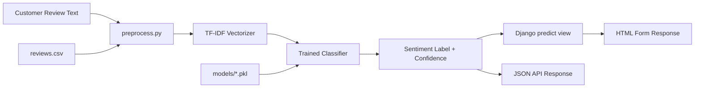

# Requirements

### Overview & Goals
Build an end-to-end sentiment classifier that labels customer reviews as **positive**, **negative**, or **neutral** using TF-IDF features and a machine learning algorithm. The classifier must be deployable as a production-ready Django web application on a Jungle server, usable by a front office team.

### Scope

**In Scope:**
- Text preprocessing pipeline (cleaning, tokenization, stopword removal, lemmatization)
- TF-IDF feature extraction from review text
- Training multiple ML models (Naive Bayes, Random Forest, SVM) and selecting the best
- Model evaluation with accuracy, precision, recall, F1-score, and confusion matrix
- Serialization of the trained model and TF-IDF vectorizer for production use
- Django web application with a form-based interface for sentiment prediction
- API endpoint for programmatic access to predictions

**Out of Scope:**
- Deep learning / transformer-based models (e.g., BERT)
- Multi-language support (English only)
- Real-time model retraining
- User authentication or role management

### User Stories
1. As a **front office analyst**, I want to paste a customer review into a web form so that I can see its sentiment label (positive/negative/neutral) instantly.
2. As a **data scientist**, I want to train and compare multiple classifiers so that I can select the best-performing model.
3. As a **data scientist**, I want evaluation metrics (accuracy, precision, recall, F1, confusion matrix) so that I can assess model quality.
4. As a **devops engineer**, I want the classifier deployed as a Django app so that it can run on a Jungle server in production.

### Functional Requirements
- **Preprocessing**: Clean text (remove HTML, special characters, URLs, extra whitespace), lowercase, remove stopwords, lemmatize.
- **Feature extraction**: TF-IDF with configurable max features, n-gram range, and min/max document frequency.
- **Training**: Support Naive Bayes, Random Forest, and SVM classifiers.
- **Evaluation**: Report accuracy, precision (per-class and macro), recall (per-class and macro), F1-score (per-class and macro), and a confusion matrix.
- **Prediction API**: Accept a review string and return the predicted sentiment label with a confidence score.
- **Web interface**: Simple HTML form with a text area for the review, a submit button, and a result display showing the sentiment and confidence.

### Non-Functional Requirements
- **Performance**: Prediction latency under 500ms per request.
- **Usability**: Clean, minimal interface — no JavaScript framework required, plain HTML/CSS with optional lightweight JS for form submission.
- **Portability**: Python 3.9+, Django 4.x, deployable on a standard Linux server (Jungle server).
- **Reproducibility**: Fixed random seeds for train/test split and model training.
- **Dataset**: The project will use a sample dataset (e.g., IMDB reviews or Amazon reviews) for training; the data loading should be pluggable so the user can swap in their own dataset.

# Technical Design

### Current Implementation
The project is a **greenfield** effort. The `review-sentiment-tfidf` directory is empty — no existing code, models, or infrastructure to build upon.

### Key Decisions

1. **Algorithm selection**: Train **three** classifiers — Multinomial Naive Bayes, Random Forest, and Linear SVM (SGDClassifier with hinge loss). Compare on F1-score and select the best. SVM with TF-IDF typically outperforms on text classification, but Naive Bayes is fast and a strong baseline.

2. **Dataset**: Use the **IMDB movie reviews** dataset (available via `datasets` or `sklearn.datasets`) extended with a neutral class, or the **Amazon product reviews** dataset. The data loader will be abstracted so the user can swap in their own CSV/JSON dataset.

3. **Model serialization**: Use `joblib` to save the trained model and TF-IDF vectorizer as `.pkl` files for production loading.

4. **Django architecture**: A single Django app `sentiment` with:
   - A `predict()` view (function-based) handling both form GET and POST
   - An API view returning JSON for programmatic access
   - Model loading at startup via Django's `AppConfig.ready()` to avoid per-request loading

5. **Project structure under `review-sentiment-tfidf/`**:

```
review-sentiment-tfidf/
├── data/
│   └── reviews.csv              # Training dataset (reviews + labels)
├── notebooks/
│   └── exploration.ipynb        # Optional: data exploration
├── scripts/
│   ├── preprocess.py            # Text cleaning and preprocessing utilities
│   ├── train.py                 # Training pipeline: load, split, TF-IDF, train, evaluate
│   └── evaluate.py              # Standalone evaluation script (reproducibility)
├── models/
│   ├── best_model.pkl           # Serialized best classifier
│   ├── vectorizer.pkl           # Serialized TF-IDF vectorizer
│   └── label_encoder.pkl        # Serialized label encoder
├── sentiment_app/               # Django project
│   ├── sentiment_app/           # Django settings, URLs, WSGI
│   │   ├── __init__.py
│   │   ├── settings.py
│   │   ├── urls.py
│   │   └── wsgi.py
│   ├── sentiment/               # Django app
│   │   ├── __init__.py
│   │   ├── apps.py              # Loads model at startup
│   │   ├── views.py             # predict() view + API view
│   │   ├── urls.py              # URL routing
│   │   ├── models_loader.py     # Model loading utility
│   │   └── templates/sentiment/
│   │       └── predict.html     # Form template
│   ├── manage.py
│   └── requirements.txt
├── requirements.txt             # Python dependencies for training
└── README.md
```

### Proposed Changes

#### Stage 1: Preprocessing and Training Pipeline
- `scripts/preprocess.py`: Functions for text cleaning (HTML removal, URL removal, special character stripping, lowercasing, stopword removal, lemmatization using NLTK).
- `scripts/train.py`: End-to-end training script that:
  - Loads the dataset from `data/reviews.csv`
  - Preprocesses text
  - Splits into train/test (80/20, stratified, random_state=42)
  - Fits TF-IDF vectorizer on training data
  - Trains three classifiers (Naive Bayes, Random Forest, SVM)
  - Evaluates each and prints comparison metrics
  - Saves the best model, vectorizer, and label encoder to `models/`

#### Stage 2: Evaluation
- `scripts/evaluate.py`: Loads saved model artifacts and evaluates on the test set. Outputs accuracy, precision, recall, F1 (per-class and macro), and a confusion matrix with a visual plot saved to `models/confusion_matrix.png`.

#### Stage 3: Django Deployment
- Create a Django project `sentiment_app` with a `sentiment` app.
- `sentiment/models_loader.py`: Loads `.pkl` files at app startup.
- `sentiment/views.py`:
  - `predict(request)`: Renders the form on GET, processes the review on POST, returns the sentiment label and confidence.
  - `predict_api(request)`: JSON endpoint accepting `{"review": "..."}` and returning `{"sentiment": "positive", "confidence": 0.92}`.
- `sentiment/templates/sentiment/predict.html`: Clean HTML form with textarea, submit button, and result display. Uses plain JS (fetch API) for async form submission.
- `sentiment/apps.py`: Overrides `ready()` to load the model into a module-level global.

### Architecture Diagram



### Risks
- **Dataset quality**: If the training data is imbalanced, the model may bias toward the majority class. Mitigation: use stratified splitting and class weights.
- **Neutral class ambiguity**: Reviews labeled "neutral" may be noisy. Mitigation: use a threshold on prediction confidence — if no class exceeds 60% confidence, label as "uncertain".
- **Model loading in Django**: If the model files are missing at startup, Django will fail. Mitigation: add a graceful error message in `apps.py` and a management command to check model health.

# Testing

### Validation Approach
Each stage will be validated by running the corresponding script and verifying the expected outputs.

### Key Scenarios

**Preprocessing:**
- Input: `"This product is AMAZING!!! Check it out at http://example.com"`
- Expected: cleaned, lowercased, stopword-removed, lemmatized tokens
- Input: `"<p>Terrible service</p>"`
- Expected: HTML tags removed, text cleaned

**Training:**
- `train.py` completes without errors
- Three models are trained and compared
- Best model is saved to `models/best_model.pkl`
- Vectorizer and label encoder are saved
- Console output shows a comparison table of metrics

**Evaluation:**
- `evaluate.py` loads model artifacts and reports metrics
- Confusion matrix plot is generated
- F1-score (macro) is above 0.75 (for a reasonable dataset)

**Django App:**
- `python manage.py runserver` starts without errors
- Visiting `/predict/` shows the form
- Submitting a positive review (e.g., "This product is amazing!") returns "positive" sentiment
- Submitting a negative review (e.g., "Terrible experience, very disappointed") returns "negative" sentiment
- API endpoint `/api/predict/` returns valid JSON

### Edge Cases
- Empty review text → return "no prediction" with a user-friendly message
- Very short review (1-2 words) → model may be uncertain; display confidence
- Review with mixed sentiment → model picks the dominant class; confidence may be lower
- Model files missing → Django shows a clear error page with instructions to run `train.py` first

### Test Changes
- Add a `tests/` directory under `scripts/` with unit tests for preprocessing functions.
- Add Django tests in `sentiment/tests.py` for the predict view and API endpoint (with a mock model).

# Delivery Steps

###   Step 1: Set up project structure and preprocessing pipeline
Create the project skeleton under `review-sentiment-tfidf/` and implement the text preprocessing utilities.
- Create directory structure: `data/`, `scripts/`, `models/`, `notebooks/`
- Implement `scripts/preprocess.py` with functions: `clean_text()`, `remove_html()`, `remove_urls()`, `remove_stopwords()`, `lemmatize()`, and a combined `preprocess_review()` pipeline
- Set up `requirements.txt` with dependencies: `numpy`, `pandas`, `scikit-learn`, `nltk`, `joblib`, `matplotlib`, `seaborn`, `django`
- Create a sample `data/reviews.csv` loader that fetches a public dataset (e.g., IMDB reviews) or provides a template for the user's own data
- Add unit tests for preprocessing functions in `scripts/tests/test_preprocess.py`

###   Step 2: Implement training pipeline with multiple classifiers
Build the end-to-end training script that trains, compares, and saves the best model.
- Implement `scripts/train.py`:
  - Load and preprocess the dataset
  - Stratified train/test split (80/20, random_state=42)
  - Fit TF-IDF vectorizer (max_features=10000, ngram_range=(1,2), min_df=2, max_df=0.95)
  - Train three classifiers: Multinomial Naive Bayes, Random Forest (n_estimators=100), Linear SVM (SGDClassifier, hinge loss)
  - Evaluate each on the test set and print a comparison table (accuracy, precision, recall, F1)
  - Save the best model, vectorizer, and label encoder to `models/` using `joblib`
- Run `train.py` to produce the initial model artifacts
- Verify model files are saved correctly

###   Step 3: Implement evaluation script with metrics and visualization
Create a standalone evaluation script that loads saved models and produces detailed metrics.
- Implement `scripts/evaluate.py`:
  - Load model artifacts from `models/`
  - Load and preprocess the test set
  - Compute and print: accuracy, precision (per-class + macro), recall (per-class + macro), F1-score (per-class + macro)
  - Generate and save a confusion matrix heatmap to `models/confusion_matrix.png`
  - Print a classification report
- Run `evaluate.py` and verify the output metrics are reasonable (F1 > 0.75 for a standard dataset)
- Add the confusion matrix image to `.gitignore` or commit as a deliverable

###   Step 4: Build Django web application with prediction interface
Create the Django project and app that serves the sentiment classifier.
- Create Django project `sentiment_app/` with `sentiment` app
- Implement `sentiment/models_loader.py`: loads `.pkl` files and exposes a `predict_review(text)` function
- Implement `sentiment/apps.py`: override `ready()` to load the model at startup with graceful error handling
- Implement `sentiment/views.py`:
  - `predict(request)`: GET renders the form, POST processes the review and displays the result
  - `predict_api(request)`: POST JSON endpoint accepting `{"review": "..."}`, returning `{"sentiment": "...", "confidence": ...}`
- Create `sentiment/templates/sentiment/predict.html`: clean HTML form with textarea, submit button, result display area, and lightweight JS (fetch API) for async submission
- Configure URL routing in `sentiment/urls.py` and `sentiment_app/urls.py`
- Add Django tests in `sentiment/tests.py` with a mock model for the views
- Update `sentiment_app/requirements.txt` with Django and ML dependencies
- Test locally: `python manage.py runserver` and verify both the form and API work

###   Step 5: Add deployment guide and finalize deliverables
Complete the project with deployment instructions and a polished README.
- Create `README.md` with:
  - Project overview and architecture
  - Setup instructions (virtualenv, pip install, NLTK data download)
  - Training instructions (how to run `train.py`, swap datasets)
  - Evaluation instructions (how to run `evaluate.py`)
  - Django deployment instructions for a Jungle server (gunicorn, nginx config, environment variables, model file paths)
  - API documentation (endpoint, request/response format)
- Create a `deployment/` directory with:
  - `gunicorn.conf.py` for production WSGI server
  - `nginx.conf` template for reverse proxy
  - `Procfile` for simple deployment
- Add `.gitignore` with Python/Django artifacts, model files, and environment files
- Final verification: run the full pipeline (train → evaluate → Django serve) end to end